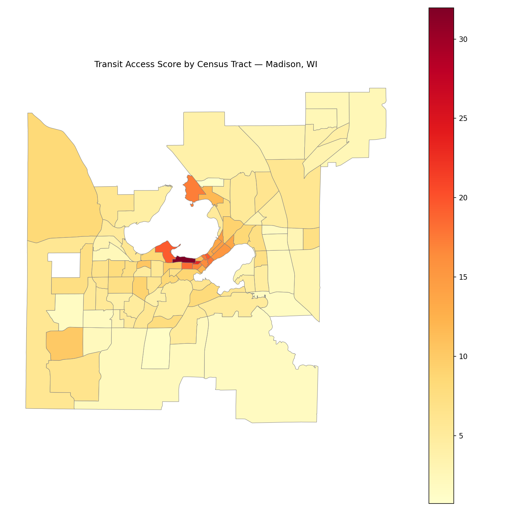
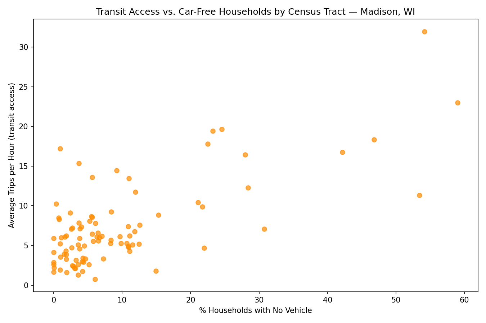
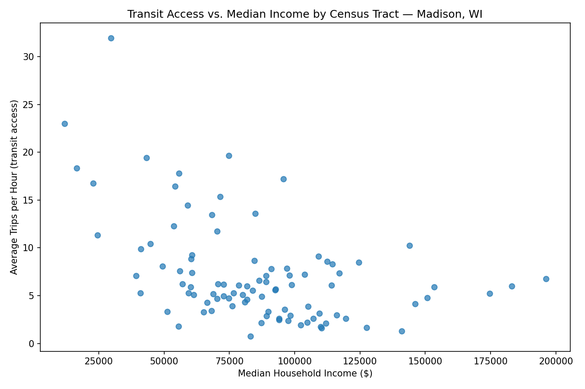

## Transit Access & Equity in Madison, WI

A data analytics project exploring who has the best access to public transit in Madison and Dane County, and whether that access lines up with income and car ownership.

Using Python, GTFS transit schedules, and U.S. Census data, I measured how frequently buses serve each census tract and compared it to neighborhood demographics to answer questions such as:

- Which parts of the city have the most frequent bus service?
- Is transit access higher in lower-income neighborhoods?
- Do tracts with more car-free households get better service?

This project focuses on combining transit and census data to show how well public transportation serves the people who rely on it most.

---

### Technologies

- `Python`
- `pandas`
- `GeoPandas`
- `Shapely`
- `Matplotlib`
- `Jupyter Notebook`
- `Census Bureau API`

---

### Analyses

- **Transit Access Score:** The average number of bus trips per hour at stops within each census tract, measured on a typical weekday from 6am to 10pm.
- **Access vs. Median Income:** Compare transit frequency to median household income across tracts.
- **Access vs. Car-Free Households:** Compare transit frequency to the percentage of households with no vehicle.
- **Spatial Map:** A tract-level map showing where service is concentrated across the city.

---

### The Process

I downloaded the Madison Metro GTFS feed and used the stop times, trips, and calendar tables to count distinct bus trips at every stop on a typical Wednesday between 6am and 10pm. Dividing by the 16-hour window gave trips per hour for each stop.

Next, I pulled 2022 American Community Survey (5-year) data for Dane County tracts through the Census API, including population, median household income, and households with no vehicle. I cleaned out suppressed values and calculated the percentage of car-free households.

Using GeoPandas, I loaded the 2022 Census tract boundaries and spatially joined each transit stop to the tract it sits in. Stop frequencies were averaged by tract and merged with the census data using the tract GEOID.

Finally, I created scatter plots and a choropleth map and calculated correlations to see how access relates to income and vehicle ownership.

---

### Key Findings

- Transit access is concentrated downtown and along the isthmus, with the highest-scoring tract near 32 trips per hour.
- Tracts with more car-free households tend to have higher transit frequency.
- Higher-income tracts tend to have lower transit frequency.
- Correlation (income vs. access): *add your value*
- Correlation (no-vehicle % vs. access): *add your value*

---

### What I Learned

#### Python

- Pulling data from web APIs and downloading files programmatically
- Cleaning and merging data from multiple sources
- Storing API keys safely with environment variables

#### Geospatial Analysis

- Working with GeoPandas and census tract shapefiles
- Spatial joins and coordinate reference systems
- Building choropleth maps

#### Data Visualization

- Scatter plots and correlation analysis
- Mapping spatial patterns in data

---

### Limitations & Future Improvements

- Tracts with no transit stops are not included in the analysis.
- Frequency doesn't capture walking distance to stops, route destinations, or travel time.
- Add other measures such as proximity to jobs, grocery stores, and healthcare
- Compare access across time of day and weekends
- Add a regression analysis controlling for population density

---

### Data Sources

- [Madison Metro GTFS Feed](http://transitdata.cityofmadison.com/GTFS/mmt_gtfs.zip)
- [U.S. Census Bureau ACS 5-Year Estimates (2022)](https://www.census.gov/data/developers/data-sets/acs-5year.html)
- [Census TIGER/Line Tract Boundaries (2022)](https://www.census.gov/geographies/mapping-files/time-series/geo/tiger-line-file.html)

---

## Connect

If you're interested in urban analytics, transportation, or data science, feel free to connect or explore the project.
